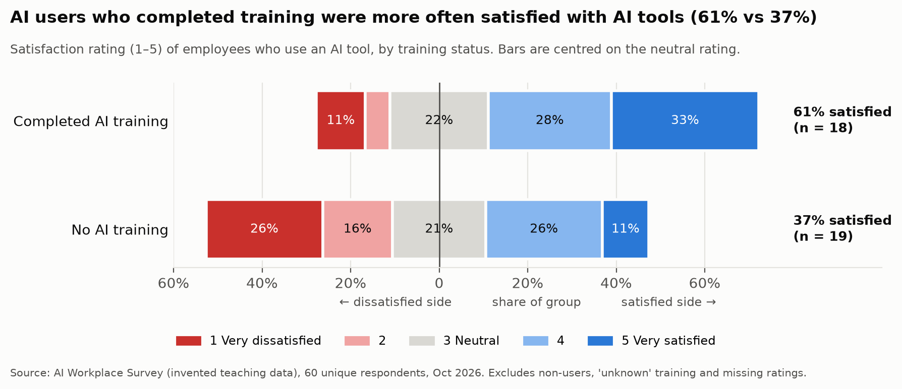
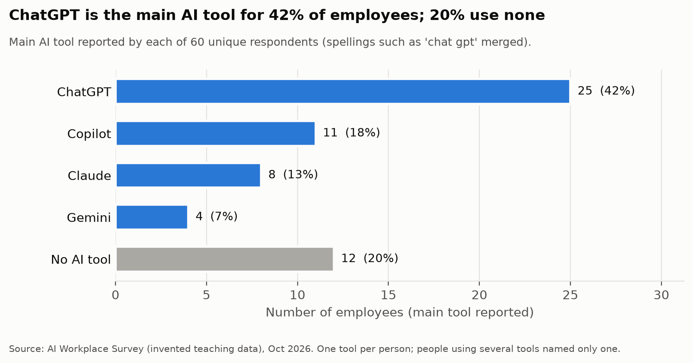

# Activity 3 – Creating meaningful visual findings

GNG/ELG 5301 · AI Workplace Survey · cleaned data from Activities 1–2
(60 unique respondents, nothing imputed).

Every number here comes from `visual_findings.py` and is listed in
[`logs/visual_findings.log`](logs/visual_findings.log). How we got here is in
[thought_process_guide.md](thought_process_guide.md); how to rebuild the charts
in Excel is in [excel_pivot_tutorial.md](excel_pivot_tutorial.md).

---

## Expected output at a glance

| | Finding 1 (main) | Finding 2 (context) |
|---|---|---|
| **Relationship / variable** | `satisfaction` (1–5) by `training_completed` (Yes / No), AI users only | Distribution of `ai_tool` (main tool per person) |
| **Chart** | Diverging stacked bar, centred on the neutral rating | Horizontal bar, sorted, axis from 0 |
| **Descriptive title** | *AI users who completed training were more often satisfied with AI tools (61% vs 37%)* | *ChatGPT is the main AI tool for 42% of employees; 20% use none* |
| **Interpretation risk** | Correlation ≠ causation (Clever Hans): trained users also use AI ~3 h/week more and may have chosen training *because* they liked the tools | Over-generalisation: 60 invented employees, one city, one month, one tool per person |
| **Boundary sentence** | see [§1.5](#15-boundary--limitation-sentence) | see [§2.5](#25-boundary--limitation-sentence) |

---

## Finding 1 – Training and satisfaction

### 1.1 The relationship

Among employees who use an AI tool **and** answered both questions, how does
their satisfaction rating differ between those who completed AI training and
those who did not?

- Population: 48 AI users → 37 left after excluding 3 with `training_completed = unknown`
  and 8 with no valid satisfaction score (the Activity 2 decision).
- Groups: **trained n = 18**, **not trained n = 19**.

### 1.2 The chart



### 1.3 What it shows (read the chart with us)

Each bar is one group, split into the five ratings and **centred on the
neutral rating (3)**: anything to the right of the centre line leans
satisfied, anything to the left leans dissatisfied. You can see the whole
shift in one glance: the trained bar sits further to the right.

- **61% of trained users rate 4–5**, against **37% of untrained users** —
  a 24-point gap.
- The bigger difference is on the left: **42% of untrained users are
  dissatisfied (1–2)**, against **17% of trained users**. Five untrained users
  gave the lowest rating, compared with two trained users.
- The neutral share is almost the same (22% vs 21%), so training is
  associated with fewer unhappy users, not just more happy ones.

### 1.4 What it does *not* show — interpretation risk

**Risk chosen: Clever Hans / correlation vs causation.** The chart invites the
reading "training makes people more satisfied". The data cannot support that:

| Check | What we found | Why it matters |
|---|---|---|
| Who chooses training? | Nothing says training was mandatory or assigned, so keen users may have signed up for it | Satisfaction could cause training instead of the other way round (reverse causation) |
| Hidden third variable | Trained users spend **9.7 h/week** on AI vs **6.9 h** for untrained | Heavier users may be both trained *and* happier; the real driver could be usage or role |
| Uneven groups | Engineering: 6 of 8 users trained; Business: 3 of 7 | A department effect could look like a training effect |
| Chance | Fisher exact test p = 0.19; **one person moves a group by ~5.5 points** | With 18 vs 19 people, a gap this size can easily appear by chance |
| Does it make domain sense? | Yes, training plausibly helps people use tools well, *and* it plausibly attracts enthusiasts | A plausible story is not proof; both directions make sense |

So the honest wording is *"were more often satisfied"* (a description of
these 37 people), never *"training increases satisfaction"*.

### 1.5 Boundary / limitation sentence

> In this invented sample of 37 AI users from one organisation, those who had
> completed AI training were more often satisfied (61% vs 37%). The groups are
> small (18 and 19), the gap could be due to chance (p = 0.19), and training was
> not randomly assigned, so the finding shows an association to investigate,
> not evidence that training causes higher satisfaction.

---

## Finding 2 – Which AI tools people use

### 2.1 The relationship

A single variable: the **main AI tool** each of the 60 unique respondents
reported, after merging spellings such as `chat gpt` / `chatgpt` / `ChatGPT`.

### 2.2 The chart



### 2.3 What it shows

- **ChatGPT leads clearly: 25 of 60 (42%)** name it as their main tool, more
  than Copilot (11), Claude (8) and Gemini (4) put together (23).
- **12 employees (20%) use no AI tool at all.** That is the second-largest
  group, and it matters for any "AI user" analysis: Finding 1 leaves these
  people out.
- Bars start at zero and are sorted, so their lengths compare honestly. "No AI
  tool" is grey and placed last because it is not a product.

This finding gives the context for Finding 1: about 4 in 5 employees use some
AI tool, and most of them use ChatGPT.

Without the label cleaning (duplicates already removed), the same chart showed ChatGPT
as only 23 people and added two extra "tools" (`chat gpt`, `chatgpt`). Cleaning changed the picture.

### 2.4 Interpretation risk

**Risk chosen: Over-generalisation.** The figure is easy to quote as "42% of
workers use ChatGPT". But:

- it is **60 people**, all with Ottawa-area postal codes, in five university-style
  departments, surveyed in **October 2026**;
- the data are **invented for teaching**;
- the question records only **one main tool**, so people using several tools are
  counted once. Copilot is often built into other software and may be
  under-reported;
- how people were invited (the sampling) is not documented, so AI enthusiasts may
  be over-represented.

### 2.5 Boundary / limitation sentence

> Among the 60 respondents to this invented October 2026 survey of one
> Ottawa-area organisation, ChatGPT was the most common main AI tool (42%) and
> 20% used none. Because each person could name only one tool and we do not know
> how respondents were selected, these shares should not be read as the tool
> market share of employees in general.

---

## The three interpretation risks, applied to our work

| Risk | Where it could bite us | What we did |
|---|---|---|
| **1. Clever Hans** (spurious signal) | Finding 1: training could be standing in for usage intensity, department or enthusiasm | Checked hours, department and job level by training group; reported p-value; worded the title as a description, not a cause |
| **2. Over-generalisation** | Finding 2: a 60-person invented sample quoted as "workers in general" | Stated the boundary (who, where, when, how many) under every chart and in both boundary sentences |
| **3. Automation bias** (numbers look objective) | Both findings rest on **self-reported** answers and on **our cleaning choices** | See below |

**Human subjectivity behind these "objective" numbers:**

- *The respondents.* Satisfaction is a personal opinion on an undocumented
  1–5 scale (we assumed 5 = most satisfied). Hours per week are guesses from
  memory, not measured. 10 people who use **no** AI tool still gave a
  satisfaction score (mean 3.8). What were they rating?
- *The survey designer.* Choosing to record one tool per person decides what
  Finding 2 can show.
- *Us.* Every cleaning decision shapes the charts: setting 400 hours and age 250 to
  missing, merging `Eng.` into Engineering, dropping 10 satisfaction answers, and
  removing the 15xx re-entries. Another team could make different, defensible
  choices and draw slightly different bars. That is why the decisions are logged
  in Activities 1–2 and the code is in this repository.

---

## Reproduce

```bash
python3 activity3_visual_findings/visual_findings.py
```

Creates `figures/*.png`, `visual_findings.xlsx` (Clean Data + both findings as
native Excel charts) and `logs/visual_findings.log`.
